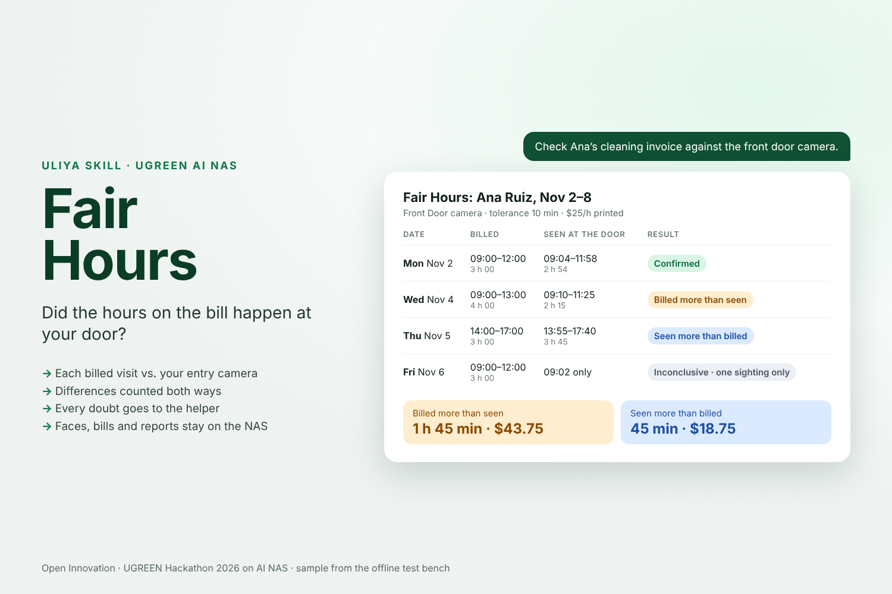
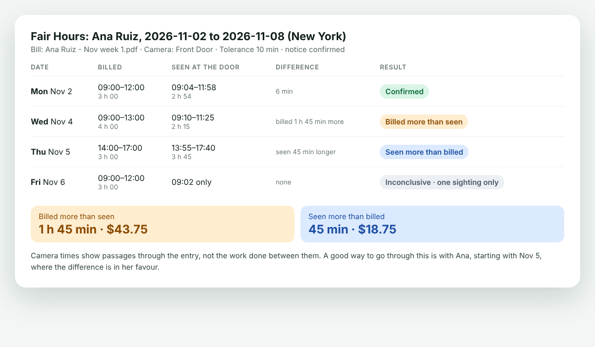

# Fair Hours

**Did the hours on the bill happen at your door?** A Uliya Skill for UGREEN AI NAS that checks a home helper's hourly bill, visit by visit, against the times the household's own entry cameras recognised that helper. Differences are counted in both directions, and the camera footage and bills never leave the NAS.

UGREEN Hackathon 2026 on AI NAS · Track: Explore Your Imagination (Open Innovation) · Round 1 entry



| | |
|---|---|
| Skill package (submitted ZIP) | [`dist/fair-hours.zip`](dist/fair-hours.zip): `SKILL.md` plus 6 references, Markdown only ([checksums](dist/SHA256SUMS.txt)) |
| Proposal (submitted PDF) | [`proposal/Fair-Hours-Round1-Proposal.pdf`](proposal/Fair-Hours-Round1-Proposal.pdf) |
| Official checker | `static-pass`: 0 errors, 0 warnings (uliya-skill-kit 0.7.3, catalog 2.0.0) |
| Test bench (35 cases, same small model both sides) | Fair Hours **31/35** cases fully right, **0** harmful calls · baseline 13/35, 8 harmful · [BENCHMARK-RESULTS.md](BENCHMARK-RESULTS.md) |
| Review in five minutes | [JUDGES.md](JUDGES.md) |
| Every claim and its evidence | [CLAIMS.md](CLAIMS.md) |

## The problem

Households pay cleaners, nannies, dog walkers and home-care aides by the hour, and the bills arrive weekly. Families either trust them blindly or keep paper logs. Medicaid has required electronic visit verification for home-care visits since the 21st Century Cures Act; families who pay privately have nothing similar. Mistakes go both ways: helpers also forget to bill time they worked.

## What it does

The user says: *"Check Ana's cleaning invoice against the front door camera."* Fair Hours:

1. confirms the helper has been told that the entry cameras recognise faces and may be used to check hours. If not, it stops before any camera query;
2. lists the cameras, keeps only entrance cameras, and confirms the helper's registered known-face name;
3. finds and reads the bill. A photographed or handwritten timesheet goes through OCR, and only printed values are used;
4. pulls only that helper's recognised arrivals and departures;
5. on doubtful dates only, pulls anonymous *passages*: the time, camera and recognised yes/no of other people, never names. These show whether the camera was recording and whether an unrecognised person could have been the helper;
6. applies a fixed [11-rule table](skill/fair-hours/references/matching-rules.md) and returns one result per visit: `Confirmed`, `Billed more than seen`, `Seen more than billed`, `Not seen`, `Inconclusive` or `Seen, not billed`. Totals for the two directions are shown side by side and priced at the printed rates, and bill arithmetic errors are flagged;
7. offers to save the report, which goes through the NAS approval prompt.

With no bill, it drafts a timesheet from the camera events for both sides to confirm.



*From a recorded bench run: [eval/v2/runs/skill-final/C01/final.md](eval/v2/runs/skill-final/C01/final.md) (Sonnet stand-in). The headline Haiku run of the same case: [eval/v2/runs/skillhaiku-r3/C01/final.md](eval/v2/runs/skillhaiku-r3/C01/final.md).*

## Every doubt goes to the helper

A generic assistant reads the timelines and guesses. Fair Hours never turns uncertainty into a negative result. Each of these gives `Inconclusive`, never `Not seen`:
- a camera outage;
- an arrival with no departure;
- an unrecognised person at the door near the billed times;
- an event list that was cut off;
- a name that was never recognised.

`Not seen` requires the cameras to have recognised *other* people during the billed time while never seeing the helper.

## Built on UGREEN AI NAS

| Expert | CLI and action | Job | Step |
|---|---|---|---|
| security-monitor-agent | `ug-surveillance` cameras, faces | entrance cameras; confirm the registered name | 1 |
| file-agent | `ug-filesystem` find | find the bill in a folder | 2 |
| document-agent | `ug-document` extract | billed visits, rates, totals (printed values only) | 3 |
| photo-agent | `ug-photo` vision-ocr | photographed or handwritten timesheets | 3 |
| security-monitor-agent | `ug-surveillance` event-timeline | the helper's recognised events; anonymous passages | 4–5 |
| security-monitor-agent | `ug-surveillance` event-evidence | snapshots, on request, for review on the NAS | 7 |
| knowledge-agent | `ug-knowledge` save-text | save the report (platform approval workflow) | 8 |

## Repository

```
skill/fair-hours/         the Skill (this folder is what dist/fair-hours.zip contains)
proposal/                 proposal source, word-counted PDF build, the PDF
eval/                     bench v1 (history) and eval/v2 (current): mock experts, scripted user, cases, scorer, recorded runs
tools/build_zip.py        builds the ZIP only if the official checker passes; re-checks the unzipped copy
(the official checker is not redistributed: get uliya-skill-kit 0.7.3 from the Hackathon Starter Kit and set ULIYA_SKILL_KIT)
loop/                     independent audit reports, ledger and state from the verified audit loop
docs/assets/              cover and sample-report images (rendered from HTML)
```

Check the Skill with the official kit:

```
node uliya-skill-kit/scripts/check-skill.mjs skill/fair-hours
```

Rebuild the submission files:

```
python3 tools/build_zip.py
python3 proposal/build_proposal.py
python3 tools/make_benchmark_md.py   # regenerates BENCHMARK-RESULTS.md and the proposal numbers from the recorded runs
```

## Honest limits

- Nothing has run on a UGREEN NAS yet; Round 1 gives no NAS access. The [validation plan](skill/fair-hours/references/validation-plan.md) lists what the finalist day must confirm: parameter behaviour, outage warnings, the response for an unknown name, and face recall on departures.
- The bench uses stand-in experts and a stand-in model, not Uliya. The numbers measure whether the rules are clear enough for a model to follow; they do not measure NAS accuracy.
- Cameras show passages through the entry, not work. Fair Hours itself calls no external service; which chat model Uliya uses to run it is a Uliya setting. Recording rules for household employees differ by place.

Independent entry; not an official UGREEN Skill. Skill text and bench © the entrant, MIT License.
