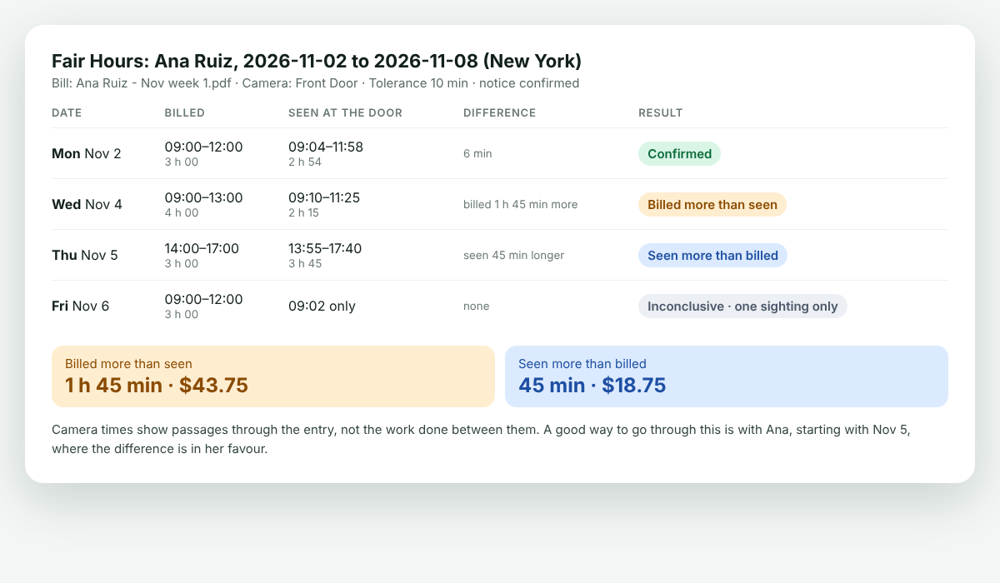

# Fair Hours

**Did the hours on the bill happen at your door? A Uliya Skill for UGREEN AI NAS** · Track: Open Innovation

## 1. What does your Skill do?

Fair Hours checks a home helper's hourly bill against the times the household's own entry cameras recognised that helper, visit by visit, in both directions, on the NAS.

## 2. Who is the target user, and what is their problem?

Households paying cleaners, nannies, dog walkers or home-care aides by the hour (2.2 million US domestic workers alone). Weekly bills get trusted blindly or checked against paper logs. Medicaid must electronically verify home-care visits (21st Century Cures Act); private payers have nothing. Errors run both ways: helpers also forget to bill time.

## 3. What is your solution?

"Check Ana's invoice against the front door camera." Fair Hours reads the bill, pulls only Ana's recognised arrivals and departures, and fixed rules give each visit one result: Confirmed, Billed more than seen, Seen more than billed, Not seen, Inconclusive, or Seen, not billed. Totals show both directions side by side, priced at printed rates, plus bill arithmetic errors. No bill? It drafts a timesheet for both sides to confirm.

{width=88%}

## 4. What is the main user flow?

Notice confirmed → cameras and registered name checked → bill found and read (OCR for photos) → helper's events → anonymous passages for doubtful dates → rules → report → optional approved save.

## 5. How is your idea different from existing tools or common AI solutions?

General assistants eyeball timelines and guess. Fair Hours gives every doubt to the helper: an unrecognised person near the door, a camera gap or a cut-off list means Inconclusive, never Not seen. On our bench, the same model without these rules made {{BASE_HARM}} harmful calls; with them, {{SKILL_HARM}}. Cloud tools would need home footage uploaded; here faces, bills and reports stay local.

## 6. Which UGREEN AI NAS features does your Skill use, and at which step?

security-monitor-agent: ug-surveillance cameras, faces (step 1), event-timeline (4–5), event-evidence (7). file-agent: ug-filesystem find (2). document-agent: ug-document extract (3). photo-agent: ug-photo vision-ocr (3). knowledge-agent: ug-knowledge save-text, approval-gated (8).

## 7. What is your technical approach?

Markdown-only orchestration: nine single-quoted delegate templates with UPPER_CASE slots filled from confirmed values; each step uses only real upstream results. An 11-rule table decides every result, in whole-minute arithmetic. All five delegation states are handled per step. Inputs: mode, registered name, period, bill or typed hours, entry cameras, tolerance, agreed terms. Permissions: read-only except one approved save; notice gate; entrance cameras only; other people counted without names; snapshots only on request. Models: the NAS experts' local models; Fair Hours itself calls no external service.

## 8. What have you built so far? What is not built yet? What still needs testing on a NAS?

Built: the Skill package (SKILL.md, six references), passing the official checker with 0 errors, 0 warnings; an offline bench of {{N_CASES}} cases (6 written blind) with mock experts and outcomes fixed before runs. Not built: any NAS run. Needs NAS testing: parameter behaviour, outage warnings, unknown-name responses, departure recognition.

## 9. How will you test your Skill if you become a Finalist?

Core 1: a PDF bill with one planned line per result, an arithmetic error, and the approved save. Core 2: Draft mode, then a photographed handwritten timesheet via OCR. Edge: camera disabled 30 minutes, and a face-turned-away walk-past; both must be Inconclusive, never Not seen.

## 10. What are the known limits, risks, or outside dependencies of your Skill?

Needs entry cameras and the helper registered as a known face. Cameras show passages, not work. Recognition misses produce Inconclusive. Workplace camera rules vary. Uliya's orchestration model follows user settings. Catalog parameter behaviour is unverified until NAS access.

---

## Declarations (excluded from the word limit)

**Entrant:** {{ENTRANT_NAME}}. **Originality:** The Skill and its core workflow were newly developed during the UGREEN Hackathon 2026 on AI NAS. No previously developed Skill or submission material is reused. **Signature:** {{SIGNATURE}}, {{DATE}}.

**Third-party components:** None in the Skill package, which contains only original Markdown. Development tools: the UGOS Skill Creation Tool (uliya-skill-kit 0.7.3, UGREEN Hackathon Starter Kit, used under its user agreement) for the capability catalog and the official checker. Claude (Anthropic) was used as an AI assistant for drafting and for the off-device test bench.

**Sources:** Economic Policy Institute, *Domestic workers chartbook* (2.2 million US domestic workers, 2019). 21st Century Cures Act §12006 (electronic visit verification for Medicaid personal care and home health visits).
